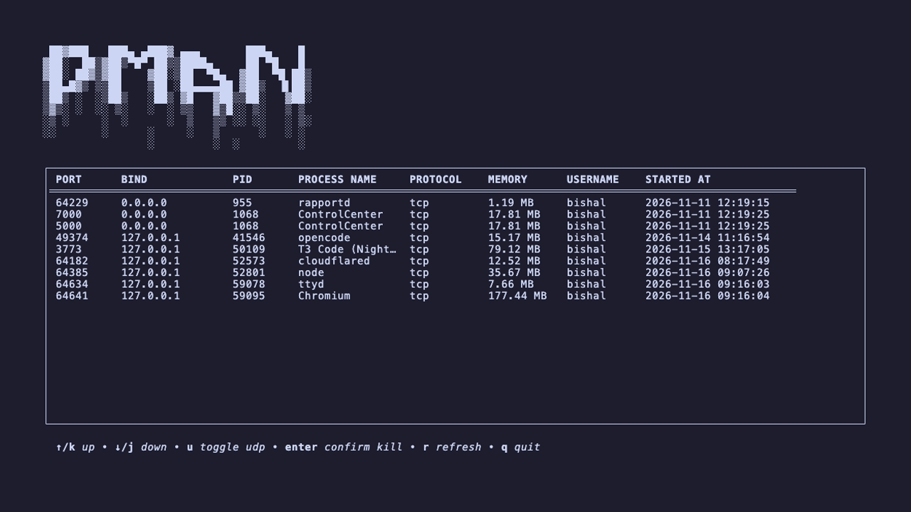

# pman

<p align="center">
  
</p>

A terminal-based process manager with a beautiful TUI for viewing and managing listening network processes.


## Preview



## Features

### TUI Features
- View all processes listening on network ports
- Display PORT, bind address, PID, Process Name, Protocol, Memory, Username, and Started At
- Human-readable memory format (KB, MB, GB)
- Auto-refresh every 2 seconds
- Manual refresh with `r`
- Vim-style navigation (`j`/`k` or arrow keys)
- Customizable color theme via `~/.config/pman/config.yaml`
- Kill processes from the TUI with confirmation (SIGTERM by default)

### CLI Commands
- `pman` - Launch interactive TUI (default)
- `pman json` - Output process list as JSON
- `pman kill [--force] <pid>` - Terminate process by PID (SIGTERM; `--force` for SIGKILL)
- `pman killport [--force] <port>` - Terminate process on port (SIGTERM; `--force` for SIGKILL)
- `pman version` - Show version information

## Installation

### Using Homebrew (Recommended on macOS)

```bash
brew tap bishalr0y/homebrew-bishalr0y
brew install pman
```

### Using go install

```bash
go install github.com/bishalr0y/pman@latest
```

### From Source

```bash
git clone https://github.com/bishalr0y/pman.git
cd pman
go install ./cmd/...
```

## Usage

### TUI Mode

```bash
pman
```

### Keybindings

| Key | Action |
|-----|--------|
| `↑` / `k` | Move up |
| `↓` / `j` | Move down |
| `Enter` | Confirm kill for selected process (`y`/`Enter` to proceed, `n`/`Esc` to cancel) |
| `r` | Refresh process list |
| `q` / `Esc` / `Ctrl+C` | Quit |

### CLI Examples

```bash
# Output processes as JSON
pman json

# Terminate a process by PID (SIGTERM)
pman kill 1234

# Force kill (SIGKILL)
pman kill --force 1234

# Terminate process on a specific port
pman killport 8080
```

## Configuration

pman reads config from `~/.config/pman/config.yaml`. On first run, it auto-creates the file with defaults:

```yaml
colors:
  banner: "#8bd5ca"
  version: "#7287fd"
  help_key: "#a6e3a1"
  help_desc: "#babbf1"
  help_separator: "#8bd5ca"
  header_fg: "#7287fd"
  selected_bg: "#7287fd"
  selected_fg: "#f9e2af"
  border_fg: "#6c7086"
```

Each key controls a specific UI element — change any hex value to customize the theme.

## Requirements

- Go 1.25 or later
- macOS or Linux

## License

MIT
